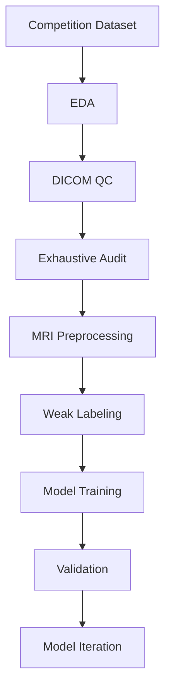
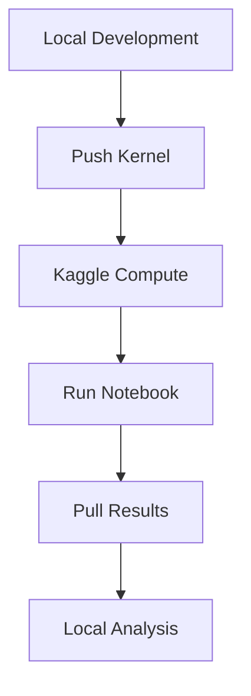

<div align="center">

# RSNA Knee Abnormality Detection

### MRI-Based Multi-Label Knee Abnormality Classification

**Kaggle Competition — Research & Machine Learning**

Research and modeling workspace for the **RSNA Knee Abnormality Detection** competition, focusing on MRI-based prediction of 12 knee abnormalities from radiology reports and DICOM imaging data.


</div>

---

# Overview

This repository contains the end-to-end research workflow developed for the **RSNA Knee Abnormality Detection** competition.

The project investigates a weakly supervised / semi-supervised learning setting in which structured pathology labels are available for only a small subset of studies, while most studies primarily contain radiology reports and MRI series.

The current workflow covers:

- Exploratory Data Analysis (EDA)
- DICOM quality auditing
- Exhaustive dataset quality assessment
- MRI preprocessing and caching
- Weak labeling from radiology reports
- Vision-based modeling with DINOv2
- Multi-label prediction across 12 knee abnormalities

The competition objective is to predict the probability of 12 abnormalities for each MRI study.

---

# Task

The model predicts probabilities for the following 12 knee abnormalities:

| Abnormality |
|---|
| ACL |
| MCL |
| Medial Meniscus |
| Lateral Meniscus |
| Medial OA |
| Lateral OA |
| PF OA |
| Effusion |
| Synovitis |
| Baker's |
| Contusion |
| Fracture |

The dataset combines MRI DICOM series, radiology reports, series metadata, and structured study-level labels.

---

# Key Dataset Finding

One of the main challenges identified during EDA is the extreme sparsity of structured pathology labels.

Approximately **98–99% of the label cells in `train.csv` are missing**, with only a small fraction of studies containing complete structured pathology annotations. At the same time, most studies contain radiology reports written in multiple languages.

This motivates a **weakly supervised / semi-supervised learning strategy** that uses radiology reports as an additional source of supervision rather than relying exclusively on the sparse structured labels.

---

# Research Pipeline



---

# Data Engineering

## DICOM Quality Audit

A large stratified quality audit examined **10,701 DICOM instances** across 342 series from 58 gold-label studies, together with additional samples stratified by anatomical plane and sequence characteristics.

Key findings:

- **98.3%** of audited instances were clean
- **0** corrupt files were detected
- **0** processing exceptions occurred
- CSV-to-disk identifiers were **100% consistent**
- 51 of 64 sampled studies were classified as usable
- 13 studies required further review
- 0 studies were excluded from the stratified sample

The audit also evaluated file validity, mandatory DICOM tags, image quality indicators, dimensions, duplicate slices, and inter-slice consistency.

## Exhaustive DICOM Audit

A subsequent exhaustive audit examined **819,078 DICOM instances** across the complete dataset.

| Metric | Result |
|---|---:|
| Total DICOM instances | 819,078 |
| Clean instances | 94.1% |
| Usable studies | 2,898 |
| Studies requiring review | 1,432 |
| Excluded studies | 77 |

Only a small number of rare anomalies were identified, including duplicate slices, orientation anomalies, empty or constant images, and corrupt files. These anomalies were concentrated in non-gold-label studies and were considered to have limited impact on the priority training set.

---

# MRI Preprocessing

The preprocessing pipeline completed processing for **24,371 / 24,371 MRI series** with:

- 0 processing errors
- 16 slices sampled per series
- Physical resampling to **0.5 mm/px**
- Sequence-group-aware intensity clipping
- Resize to **224 × 224**
- Exact duplicate-slice removal

The resulting cache is stored in Kaggle and represented as:

```text
image_cache/
└── <StudyUID>/
    └── <SeriesUID>.npz
```

Each cached series contains:

```text
(16, 224, 224) uint8
```

with metadata stored in `series_manifest.csv` and `study_manifest.csv`.

---

# Laterality Analysis

A key dataset characteristic was identified after processing all 24,371 series:

| Laterality | Series | Percentage |
|---|---:|---:|
| Right | 6,047 | 24.8% |
| Left | 5,953 | 24.4% |
| Missing | 12,367 | 50.7% |

The dataset therefore contains a substantial mixture of left- and right-knee studies, while laterality is missing for approximately half of the series.

This has direct implications for image augmentation. Horizontal flipping may require a corresponding **Medial ↔ Lateral label transformation** rather than being treated as a label-preserving augmentation.

---

# Weak Labeling from Radiology Reports

Because structured labels are sparse, a rule-based weak-labeling pipeline was developed from radiology reports.

The system incorporates:

- Negation handling
- Uncertainty detection
- Clause-level analysis
- Multi-language processing across 9 languages
- Location-aware osteoarthritis labeling
- Co-occurrence of pathology and anatomical location within the same clause

Validation against the 58 gold-label studies produced:

| Metric | Score |
|---|---:|
| Agreement | 0.747 |
| Precision | 0.686 |
| Recall | 0.951 |

The resulting weak-label dataset contains **4,407 studies**, consisting of 58 gold-label studies and 4,349 weakly labeled studies.

---

# Modeling

The current primary architecture uses **DINOv2-Base** as the vision backbone.

```text
DINOv2-Base
     │
     ▼
Slice-Level Feature Extraction
     │
     ├── CLS Representation
     └── Mean Patch Representation
     │
     ▼
Cross-Slice Aggregation
     │
     ▼
Anatomically Structured Slot Attention
     │
     ▼
12-Label Sigmoid Classifier
```

The model organizes MRI series into six anatomically informed slots based on:

- Anatomical plane
- Fluid-sensitive sequence

The final prediction head produces probabilities for all 12 abnormalities.

The implementation uses the final two DINOv2 blocks as trainable layers while retaining the pretrained backbone for the remaining layers.

---

# Experiment History

| Version | Outcome |
|---|---|
| v1–v2 | Failed because of `kernel_sources` path discovery and GPU / PyTorch compatibility issues |
| v3 | Successful end-to-end test on 40 studies for 1 epoch |
| v4 | Full 5-epoch run completed, but validation macro AUC remained near 0.50 |
| v5 | Diagnostic run identified invalid cached image paths as the root cause |
| v6 | Path handling fixed and the training-label source replaced with a stronger public report-label dataset |

## v4 Failure Analysis

The v4 run completed without explicit runtime errors but produced a validation macro AUC of approximately **0.50** across epochs.

A diagnostic run revealed that the `cache_path` values stored in the preprocessing manifest were not valid after the preprocessing kernel was mounted through `kernel_sources`. Image-loading failures were silently swallowed by an overly broad exception handler, causing the model to operate on effectively empty image inputs and learn primarily label bias.

## v6 Fix

The v6 pipeline introduced:

- Path reconstruction from the discovered preprocessing directory
- A `DATA_OK` guard that aborts training when image inputs are unavailable
- A stronger public report-label dataset as the training-label source

The fix was confirmed by a measurable increase in inter-study embedding variation:

```text
Embedding variation: 0.3870
(previously: 0.0000)
```

Validation macro AUC subsequently improved across three epochs:

```text
Epoch 1   0.6906
Epoch 2   0.7507
Epoch 3   0.7658
```

**Best recorded validation macro AUC: 0.7658**

---

# Kaggle Execution Workflow

The project is designed around a **Kaggle-first execution workflow** because the original dataset contains hundreds of thousands of DICOM files.



This setup keeps compute-intensive processing close to the competition dataset while maintaining local research notes, code organization, and result tracking.

### Typical Kernel Workflow

```bash
cd kaggle_kernel
kaggle kernels push -p .
```

Check execution status:

```bash
kaggle kernels status dimaspashaakrilian/rsna-knee-abnormality-detection-eda
```

Pull completed outputs:

```bash
kaggle kernels output dimaspashaakrilian/rsna-knee-abnormality-detection-eda -p ../eda_results
```

> **Operational note:** Kaggle's kernel status, logs, and output APIs may lag behind actual execution. A completed computation can remain visible as running for several minutes, so API status alone should not be treated as an immediate indication of a stalled kernel.

---

# Repository Structure

```text
.
├── kaggle_kernel/
│   └── EDA notebook + kernel metadata
│
├── kaggle_kernel_audit/
│   └── Stratified DICOM quality audit
│
├── kaggle_kernel_audit_full/
│   └── Exhaustive DICOM audit
│
├── kaggle_kernel_preprocessing/
│   └── MRI preprocessing and cache generation
│
├── kaggle_kernel_weak_labeler/
│   └── Radiology-report weak labeling
│
├── kaggle_kernel_modeling/
│   └── DINOv2-based modeling
│
├── reference_metadata/
│   └── Local copies of competition metadata
│
├── docs/
│   └── RESEARCH_NOTES.md
│
├── eda_results/
├── audit_results/
├── audit_results_exhaustive/
├── weak_labeler_results/
├── modeling_results/
│
└── PROGRESS.md
```

---

# Technology Stack

| Category | Technology |
|---|---|
| Language | Python |
| Deep Learning | PyTorch |
| Vision Backbone | DINOv2-Base |
| Medical Imaging | DICOM / pydicom |
| Experiment Platform | Kaggle |
| Data Processing | NumPy / Pandas |
| Report Processing | Rule-based NLP |
| Execution | Kaggle Kernels |

---

# Research Roadmap

- [x] Exploratory Data Analysis
- [x] Stratified DICOM quality audit
- [x] Exhaustive DICOM audit
- [x] MRI preprocessing pipeline
- [x] Weak-labeling pipeline
- [x] DINOv2 baseline
- [x] Diagnose and fix invalid preprocessing paths
- [x] Validate corrected training pipeline
- [ ] Extend training schedule
- [ ] Evaluate stronger vision backbones
- [ ] RadImageNet experiments
- [ ] BiomedCLIP experiments
- [ ] Improve multi-series aggregation
- [ ] Further weak-label validation
- [ ] Evaluate ensemble strategies

---

# Competition Information

| Item | Details |
|---|---|
| Competition | [RSNA Knee Abnormality Detection](https://www.kaggle.com/competitions/rsna-knee-abnormality-detection) |
| Platform | Kaggle |
| Category | Research |
| Deadline | October 22, 2026 |
| Prize Pool | $77,000 |
| Current Focus | MRI-based multi-label abnormality prediction |

---

# Kaggle Kernels

The major stages of the workflow are implemented as separate Kaggle kernels:

| Stage | Kaggle Kernel |
|---|---|
| EDA | [RSNA Knee Abnormality Detection — EDA](https://www.kaggle.com/code/dimaspashaakrilian/rsna-knee-abnormality-detection-eda) |
| DICOM Audit | [RSNA Knee DICOM Quality Audit](https://www.kaggle.com/code/dimaspashaakrilian/rsna-knee-dicom-quality-audit) |
| Exhaustive Audit | [RSNA Knee DICOM Full Exhaustive Audit](https://www.kaggle.com/code/dimaspashaakrilian/rsna-knee-dicom-full-exhaustive-audit) |
| Preprocessing | [RSNA Knee Preprocessing Pipeline](https://www.kaggle.com/code/dimaspashaakrilian/rsna-knee-preprocessing-pipeline) |
| Weak Labeling | [RSNA Knee Weak Labeler from Reports](https://www.kaggle.com/code/dimaspashaakrilian/rsna-knee-weak-labeler-from-reports) |
| Modeling | [RSNA Knee Modeling v11 — DINOv2, unfreeze6 + split-LR + grad checkpoint](https://www.kaggle.com/code/dimaspashaakrilian/rsna-knee-modeling-v11-fix-oom-grad-checkpoint) |

---

# Research Notes

Detailed methodological decisions, dataset investigations, architecture experiments, implementation discoveries, and experiment logs are documented separately in:

```text
docs/RESEARCH_NOTES.md
PROGRESS.md
```

These files preserve the full experimental history behind the summarized workflow presented in this README.

---

# Disclaimer

This repository documents an ongoing machine learning research workflow for the **RSNA Knee Abnormality Detection** competition.

Reported metrics represent **internal validation results** from the current experimental pipeline and should not be interpreted as final competition performance or clinical performance.

The workflow is intended for research and competition purposes and is **not a clinically validated diagnostic system**.

---

# Author

**Krazy Kiler**

Research and development repository for the RSNA Knee Abnormality Detection competition.
