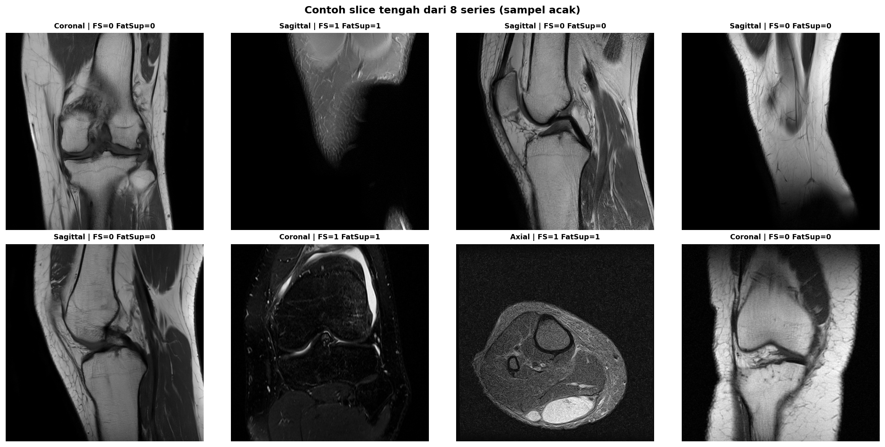
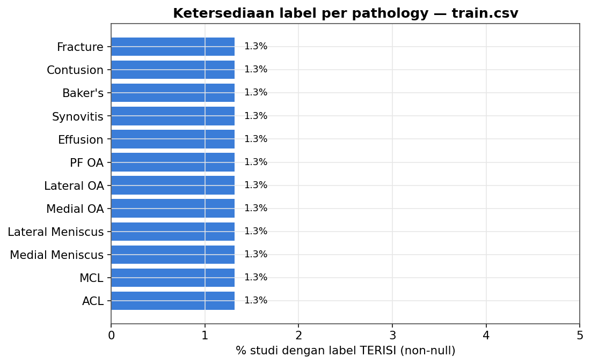
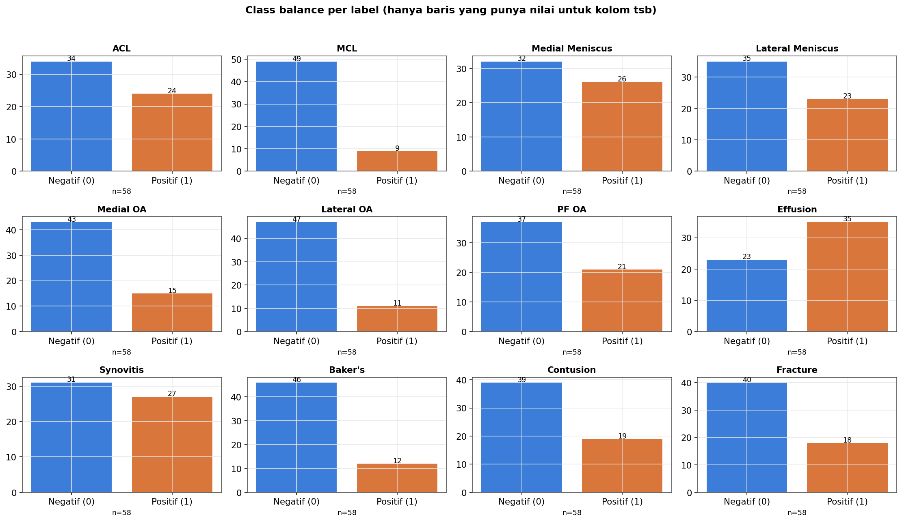
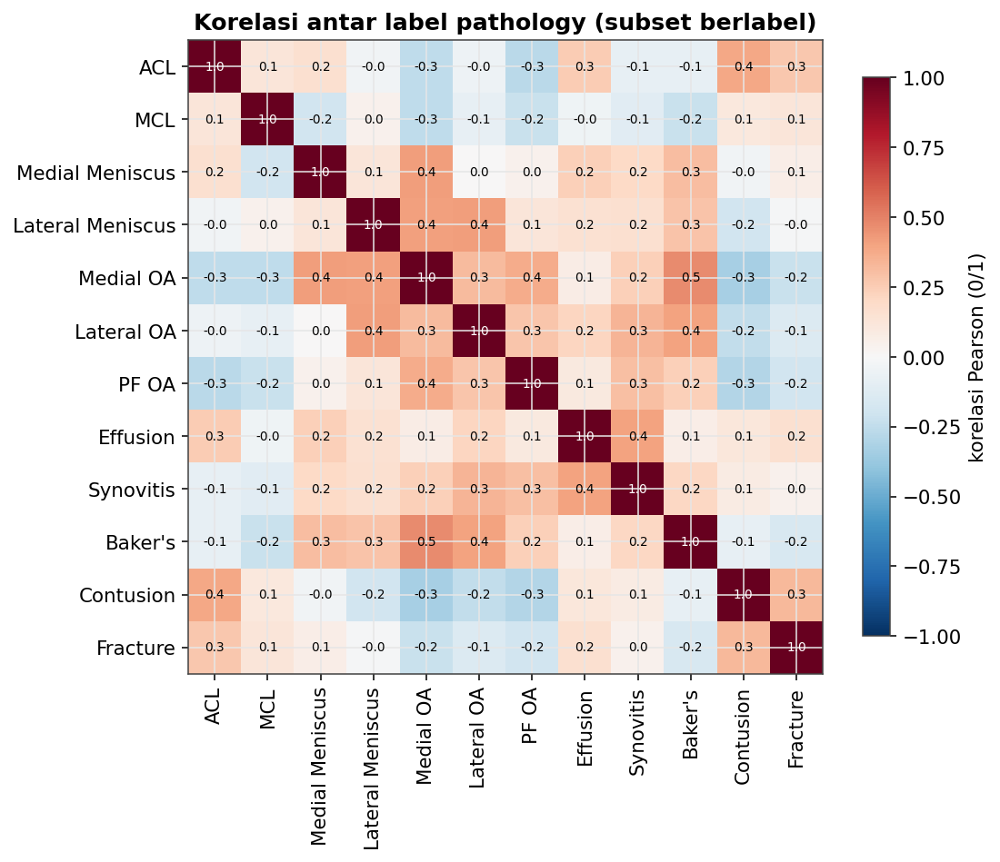
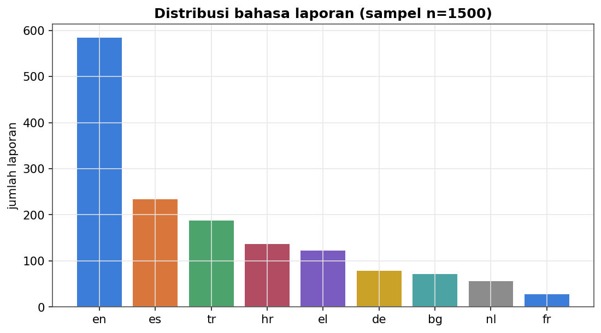
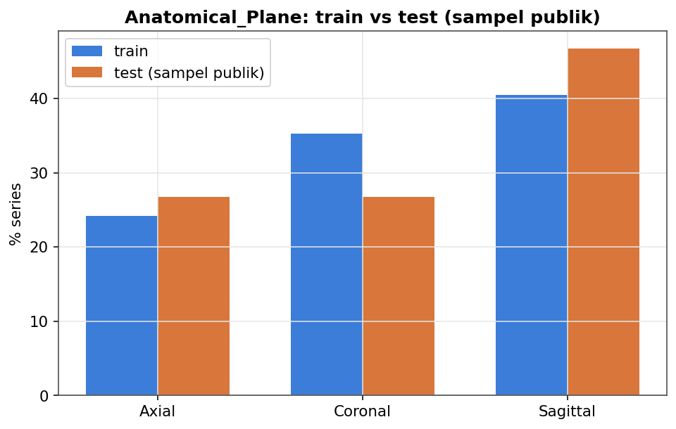
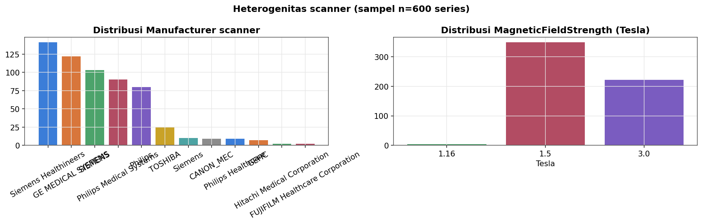

<div align="center">

# 🦵 RSNA Knee Abnormality Detection

**Weak labels from radiology reports + a 3-family MRI ensemble, built for a code competition with no internet and a 9-hour limit.**


-success)


[Task](#-the-task) · [How it works](#-how-it-works) · [Results](#-results) · [What failed](#-what-did-not-work) · [Repo map](#-repository-map) · [Run it](#-quick-start)

</div>

---

## 🖼️ Sample MRI slices

<div align="center">



</div>

## 📊 What the data looks like

| Label availability | Class balance | Label correlation |
|:---:|:---:|:---:|
|  |  |  |
| **Report language** | **Plane vs. test set** | **Scanner heterogeneity** |
|  |  |  |

## 🎯 The task

Predict the probability of **12 knee abnormalities** per MRI study (ACL, MCL, medial/lateral meniscus, medial/lateral/PF OA, effusion, synovitis, Baker's, contusion, fracture). Metric: macro ROC-AUC, 30% public / 70% private split. Code competition: internet off, run ≤ 9 h.

## 🤔 Why this is hard

- **~98–99% of structured label cells are missing.** Only 58 "gold" studies have complete labels; most studies only have a radiology report, in 9 languages.
- **Laterality is missing for ~50% of series**, so a horizontal flip is not label-preserving (medial ↔ lateral must swap).
- **819,078 DICOM instances** across 24,371 series: the audit found 94.1% clean, a handful of duplicate / constant / corrupt slices.
- **Gold-58 is too small to rank models**: SE ≈ 0.01, while the leaderboard is separated by 0.001.

## 🔄 How it works

```
 DICOM (24,371 series)
        │  audit → 16 slices/series → 0.5 mm/px → 224² cache
        ▼
 Radiology reports ──► rule-based weak labeler (negation, uncertainty,
        │              clause-level, 9 languages)  → 4,407 labeled studies
        ▼
 ┌───────────────────────┬──────────────────────┬─────────────────────────┐
 │ Raptor family         │ compact R6 (+flip)   │ our "student" family    │
 │ 384 + mirrored 224    │ public checkpoints   │ ConvNeXt-T 2.5D,        │
 │ public checkpoints    │                      │ distilled from OOF      │
 │ + S6F in half of it   │                      │ teacher consensus       │
 └───────────┬───────────┴──────────┬───────────┴────────────┬────────────┘
             └──────── per-finding weights (V2) ──────────────┘
                                    ▼
                      12 probabilities per study
```

Slot rule learned the hard way: **a new model goes inside the slot of its own family**, never as a third leg (a student in the Raptor slot always lowered the public score).

## 🏁 Results

| Item | Value |
|---|---|
| Public LB (final) | **0.958**, rank **757 / 6,299** (public silver line was inside the 0.958 block) |
| Private LB, both selected finals (`g6a`, `g8a`) | **0.944** |
| Selected finals | `g6a` (57296301), `g8a` (57315276) — chosen because they were our two highest unrounded public scores and the only *unique* recipes |
| Submissions | 156 by the team |

Honest reading: the 0.958 plateau was a public-notebook recipe shared by ~1,300 teams. Our contribution on top was the S6F placement, per-finding weights, and a distilled student; none moved the public score above 0.958.

## ❌ What did not work

| Idea | Outcome |
|---|---|
| Student as a third leg / inside the Raptor slot | Public 0.957 (down) |
| B-leg (`g13`) | Gold-58 0.9415 and OOF +0.0033, but public 0.957 → gold-58 cannot choose between 0.957 and 0.958 |
| 24-channel two-plane model | Gold 0.8346; hurt every blend weight |
| Part B reader leg | Neutral after rounding; not worth the compute |
| Label v3 student (r3) | No gain over r2a (0.9292 vs 0.9334 gold) |

## 🗺️ Repository map

```text
.
├── build_*.py              Kaggle kernel generators (train / OOF / inference / submit)
├── kaggle_kernel_*/        one folder per pushed Kaggle kernel (metadata + notebook)
├── eda_results/            EDA figures          audit_results*/  DICOM audit outputs
├── weak_labeler_results/   report-label validation
├── blend_results/          OOF blend sweeps     label_engineering/  label v1–v6
├── reports/                dated research notes (Indonesian)
├── docs/                   plans, permissions, research notes
├── MEMORY.md  HANDOFF.md  STRATEGI_SILVER.md  PROGRESS.md   full decision log
└── data/                   run logs, small manifests (heavy artifacts are gitignored)
```

## ⚡ Quick start

ML runs on Kaggle only (the competition data is DICOM-scale); the local machine drives it through the CLI.

```bash
pip install kaggle
cd kaggle_kernel && kaggle kernels push -p .          # run EDA on Kaggle
kaggle kernels status <user>/<kernel-slug>             # poll
kaggle kernels output <user>/<kernel-slug> -p ../eda_results
```

Credentials (`kaggle.json`, `akun_kaggle/`) are gitignored; never commit them.

## 📚 Credits

Our final recipes built on public work. Thanks to the authors of the public notebooks and datasets we used or tested: `goodpjw2008` (CoAtNet + R6 + 2.5D MIL), `heliosli` (per-finding weights), `nartaa` (S6F), `evgendvorkin` (Versia-7), `kritikabenjwal` (B-leg, soft labels), and the RSNA organizers.

## ⚠️ Disclaimer

Research and competition code. **Not a clinically validated diagnostic system.**

<div align="center">

**Team Krazy KIller** · [Kaggle competition page](https://www.kaggle.com/competitions/rsna-knee-abnormality-detection)

</div>
